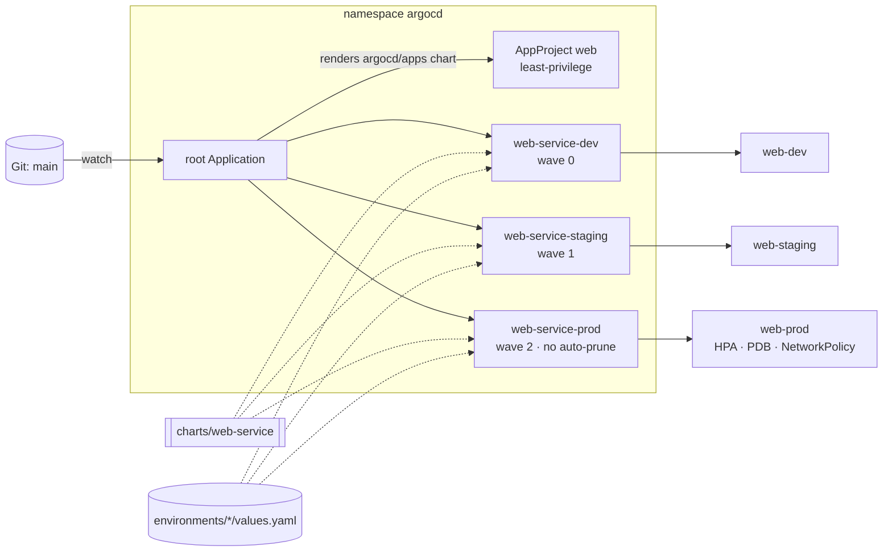
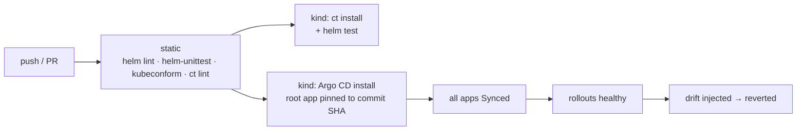

# gitops-helm-demo

[](https://github.com/HOFFMAN-ALTERNATIVE/gitops-helm-demo/actions/workflows/ci.yml)


A GitOps reference where Git is the only way to change prod. One hardened Helm chart is promoted through dev, staging and prod by an Argo CD app-of-apps. Every commit is proven in CI: 29 helm-unittest cases, kubeconform against Kubernetes 1.31 and the Argo CD CRDs, a real install on a throwaway kind cluster, and an Argo CD reconciliation drill where manual drift must be reverted by self-heal.

The trade-off: one chart, one cluster, one repo. Multi-cluster fan-out, secrets management and image promotion automation are out of scope and listed under Limits.

## Architecture





## What's in the box

| Path | Purpose |
|---|---|
| `charts/web-service` | Generic stateless HTTP service chart: Deployment, Service, ServiceAccount, ConfigMap, HPA, PDB, NetworkPolicy, Ingress, `helm test` hook |
| `charts/web-service/values.schema.json` | JSON-schema guard rails: rejects root containers, privilege escalation, malformed digests, pods without requests |
| `argocd/root-app.yaml` | The only thing you `kubectl apply` by hand |
| `argocd/apps` | App-of-apps chart: AppProject + one Application per environment, revision passed down from the root |
| `environments/{dev,staging,prod}` | Per-environment values, the only files a normal change touches |
| `scripts/validate.sh` | Renders every env + the app-of-apps and validates with kubeconform (incl. Argo CD CRD schemas) |

### Secure by default

- `runAsNonRoot`, read-only root filesystem, all capabilities dropped, `RuntimeDefault` seccomp
- no service-account token mounted unless asked for
- deny-by-default ingress NetworkPolicy (same namespace, plus explicitly labelled namespaces)
- zero-downtime rollouts (`maxUnavailable: 0`), PDB, topology spread across nodes
- config changes roll pods via a checksum annotation; images can be pinned by digest
- AppProject restricts source repo, destination namespaces and the resource kinds Argo CD may create

### Promotion model

| Env | Replicas | Sync | Prune | Notes |
|---|---|---|---|---|
| dev | 1 | auto | yes | debug logging |
| staging | 2 | auto | yes | prod shape, reduced scale |
| prod | HPA 3–10 | auto + self-heal | **no** | PDB `minAvailable: 2`, ingress opt-in per cluster |

Sync waves order the rollout (project → dev → staging → prod). Prod never auto-prunes, so a bad commit
cannot delete production resources; removals need an explicit, reviewed sync.

## Quick start

```bash
make ci                     # helm lint + helm-unittest + kubeconform
make kind-up                # kind cluster + Argo CD
make bootstrap              # apply the root app; Argo CD does the rest
kubectl -n argocd get applications
```

Point `argocd/root-app.yaml` and `argocd/apps/values.yaml` at your fork to drive your own cluster.

## Tests

- helm-unittest: 29 cases across both charts (security context, digest pinning, HPA/replicas
  interplay, config checksum, NetworkPolicy shape, schema rejections, sync waves, prod no-prune, revision pinning)
- kubeconform `-strict` against Kubernetes 1.31 + Argo CD CRD schemas for every environment
- chart-testing lint and install on kind for every `ci/*-values.yaml`, followed by `helm test`
- GitOps e2e: Argo CD on kind syncs the app-of-apps at the exact commit under test, all three
  environments roll out, then manual drift (`kubectl scale`) is injected and must be reverted by self-heal

## Limits

- Single cluster. Multi-cluster delivery would need ApplicationSets or one root app per cluster.
- No secrets management. Plug in External Secrets, Sealed Secrets or SOPS before putting credentials in values.
- Promotion is a manual edit of `environments/<env>` values (image tag or digest). No image updater or automated promotion PRs.
- No `preStop` hook or configurable termination grace period in the chart; the app is expected to drain on SIGTERM within the Kubernetes default of 30 s.
- Ingress is opt-in and assumes an existing controller and TLS issuer.

Security notes: [SECURITY.md](SECURITY.md).

## License

MIT
